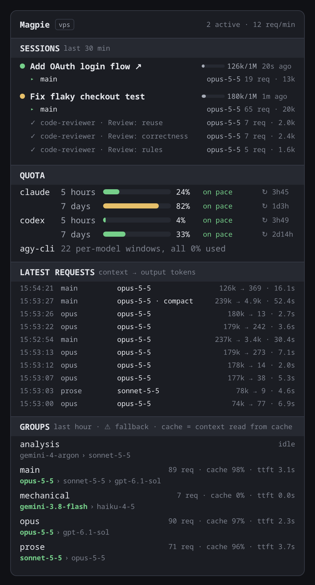

# herdr-magpie-routing

**See which model is actually answering your coding agents, live, from inside your terminal workspace.**

A panel for [Herdr](https://herdr.dev/) ([GitHub](https://github.com/herdrdev)) that shows what [magpie](https://usemagpie.ai/) ([GitHub](https://github.com/yetone/magpie)) is doing with your requests: every Claude Code session and subagent, the model that served it, fallbacks, cache hits and how much quota is left.

<p align="center">
  
  <br><sub>Mock render of the panel from real usage data, with session titles replaced. Herdr's own styling differs slightly.</sub>
</p>

## Why

magpie routes each request to a group of models with fallbacks. That's great until you wonder: *is this session on Opus or did it fall back? Why is it slow? How close am I to the 5-hour limit?* The answers are all in magpie's log, but not where you're looking. This panel puts them next to your panes.

- **Sessions:** each Claude Code session with its title, context fill and every subagent, its model, requests and output tokens. Click to jump to its pane.
- **Quota:** one bar per account window, with reset time and whether you're on pace.
- **Latest requests:** group asked → model served, context → output tokens, duration.
- **Groups:** each fallback chain with the last-served model highlighted, cache-hit share and time to first token.
- **Toasts** when a request fails or a group falls back.

It only reads magpie's files on the machine where magpie runs. No gateway key, no proxy, nothing written.

## Quick start

You need [Herdr](https://herdr.dev/), [magpie](https://usemagpie.ai/) routing your agents, and Node 18+ on the magpie machine.

```sh
git clone https://github.com/Sarimarcus/herdr-magpie-routing ~/dev/tools/herdr-magpie-routing
```

**Herdr desktop app (Windows), magpie on a remote machine:**

```powershell
scp you@your-vps:dev/tools/herdr-magpie-routing/install-windows.ps1 .
powershell -ExecutionPolicy Bypass -File install-windows.ps1 -Vps you@your-vps -Machine vps
```

A **Magpie** button appears next to Files and Changes in the right-hand panel.

**Herdr terminal (Linux, macOS):**

```sh
herdr plugin link ~/dev/tools/herdr-magpie-routing
```

Then run the **Open magpie routing tab** action. Or skip Herdr entirely: `node bin/view.js`.

## Docs

- [Install](docs/install.md): both installers in detail, updating, uninstalling
- [Reading the panel](docs/panel.md): every section, symbol and colour
- [Configuration](docs/install.md#configuration): machine, binary, thresholds
- [Troubleshooting](docs/troubleshooting.md)
- [Contributing](CONTRIBUTING.md) · [Changelog](CHANGELOG.md)

## Limits

- The context bar guesses each session's window: 1M if a subagent ran on a `[1m]` model or the context has passed 200k, else 200k. Non-Claude models show a token count without a bar.
- Sessions are matched to Herdr panes by terminal title. A session whose title is shared with another pane is not clickable.
- Group chains are parsed from the text output of `magpie groups`, which has no JSON option.
- The desktop installer is Windows-only for now. The mod itself is platform-neutral: see [Install](docs/install.md#other-desktop-platforms).

## License

[MIT](LICENSE). Not affiliated with Herdr or magpie.
