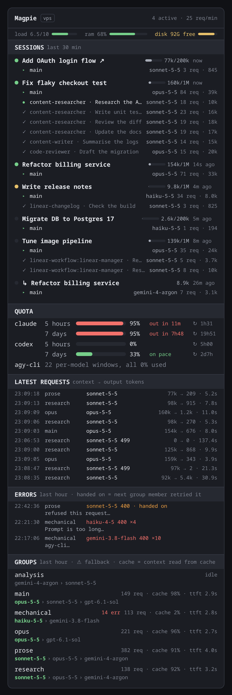

# Reading the panel

*Mock render from real usage data, with session titles replaced and the error message shortened.*

## Header

`Magpie [vps]   2 active · 12 req/min`

The machine being read, the number of sessions that made a request in the last 5 minutes, and the request rate averaged over those 5 minutes.

## Sessions (last 30 min)

One block per Claude Code session that made a request in the last 30 minutes, newest first.

| Element | Meaning |
|---|---|
| ● green / yellow / grey | Last request under a minute ago, under 5 minutes ago, older |
| ● red | One of the session's agents failed its last request |
| Title | The session's Claude Code title (custom title, else the AI-generated one). A headless `claude -p` run, such as a cron job, has none and reads `headless · <slash command or first prompt line>` |
| ↗ | The session is open in a Herdr pane: click to focus it |
| `126k/1M` bar | Context used in the latest request against the guessed window (see Limits in the README) |
| `20s ago` | Time since the session's last request |

Under each session, one line per agent:

| Prefix | Meaning |
|---|---|
| `▸ main` | The main agent |
| `● <type> · <description>` | A running subagent |
| `✓ <type> · <description>` | A finished subagent |
| ✕ | The agent's last request failed |
| ◌ | A running subagent has been silent for 5 minutes |

Each line ends with the model that served its latest request (orange with ⚠ when that was a fallback), its failed-request count if any, its request count and its output tokens.

Only the 5 newest finished subagents get a line. Older ones fold into `✓ +N finished`, with their total requests and output tokens. A finished subagent that failed always keeps its own line.

## Quota

One bar per account window that `magpie accounts --json` reports: 5-hour, 7-day and per-model windows.

- **Bar colour:** green below 70%, yellow from 70%, red from 90%.
- **Pace:** at the window's average rate so far, `on pace` (green) when it lasts until the reset, otherwise `out in <time>` (red).
- **↻** time until the window resets.

Accounts with many per-model windows that are all unused collapse into one line.

## Latest requests

The last 10 requests: time, the group or model asked for, the model that served it, context → output tokens, and duration.

| Tag | Meaning |
|---|---|
| `· compact` / `· web_search` | The request kind, when it isn't an ordinary turn |
| status code | Shown after the model when it isn't 200 |
| red model | Failed. Cancelled (499) or handed-on requests are not failures |

## Errors (last hour)

The last 5 distinct errors with their message: time, group asked, model and status. Repeats of the same error show once, at their latest time, with a count (`×4`).

- **Red:** a real failure; the agent got the error.
- **Orange, `handed on`:** magpie passed the request to the group's next member, so the agent never saw it. This is what shows up as a fallback (⚠) elsewhere. A safety-filter refusal on one model, for example, often lands here.

Cancelled requests (499) aren't listed.

An agent whose requests failed also gets its latest error, in red, on a line under it in Sessions.

## Groups (last hour)

Each magpie group with its fallback chain, `first › second › third`. The member that served the group's latest request is highlighted, with ⚠ when it isn't the first.

On the right: failed requests (`N err`) if any, requests in the last hour, **cache** (the share of context read from the prompt cache) and the median **ttft** (time to first token). `idle` means no requests in the hour.

## Toasts

A toast appears when a request fails or a group falls back to its next member. Each group and kind toasts at most once every 10 minutes. Toasts start only after the first read, so opening the panel never replays old failures.
